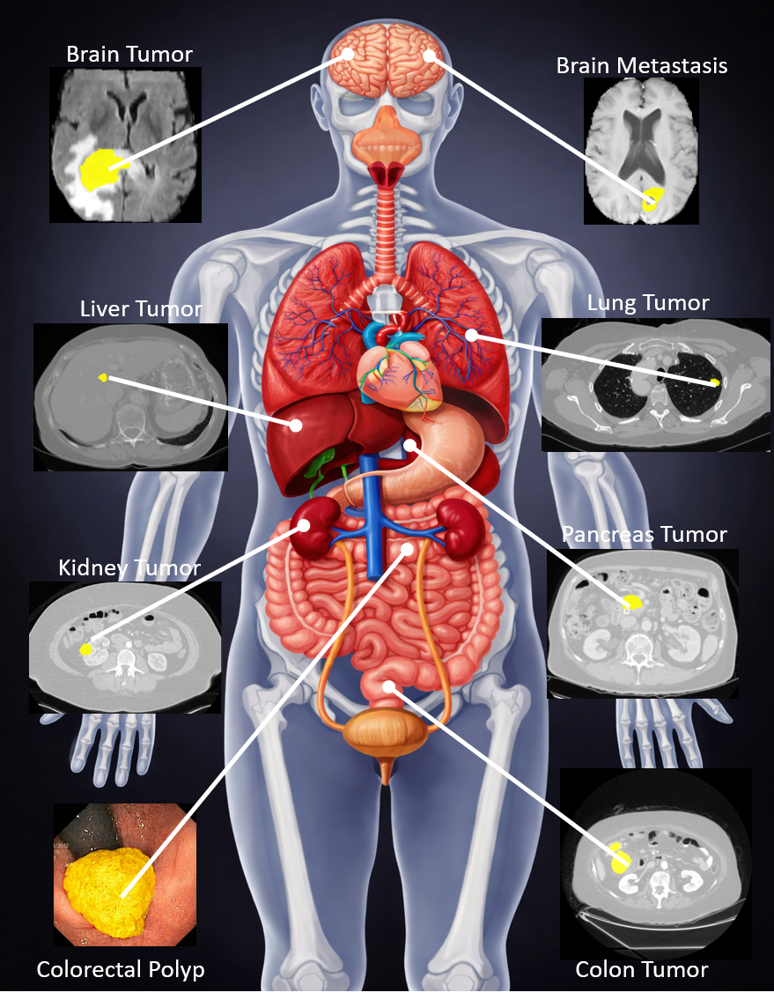

# lesion-sam3

**Adapting Segment Anything Model 3 for Concept-Driven Lesion Segmentation in Medical Images: An Experimental Study**

📄 Paper: https://arxiv.org/abs/2603.25945  
📦 Code: https://github.com/apple1986/lesion-sam3  

---

## 🚀 Overview

Accurate lesion segmentation is a cornerstone of medical image analysis, yet most existing methods are tailored to specific anatomical regions or imaging modalities, limiting their applicability in diverse clinical scenarios.

Recent advances in **vision-language foundation models** have enabled **concept-driven segmentation** in natural images, offering a promising direction toward more flexible and generalizable medical image analysis. However, concept-based prompting for lesion segmentation—especially with the latest **Segment Anything Model 3 (SAM3)**—remains largely unexplored.

In this work, we present a **systematic and comprehensive study** of adapting SAM3 for lesion segmentation across heterogeneous medical imaging domains.

---

## 🧠 Key Contributions

- ✅ **Concept-Driven Segmentation Framework**  
  Investigates SAM3 with:
  - Geometric prompts (bounding boxes)  
  - Concept-based prompts (text descriptions and exemplar images)

- ✅ **Cross-Modality Evaluation**  
  Extensive experiments across diverse imaging modalities:
  - Multiparametric MRI  
  - CT  
  - Ultrasound  
  - Dermoscopy  
  - Endoscopic imaging  

- ✅ **Knowledge-Enhanced Input Representation**  
  Improves segmentation performance by incorporating:
  - Adjacent slice predictions  
  - Multiparametric imaging information  
  - Prior annotations  

- ✅ **Comprehensive Fine-Tuning Study**  
  Comparison of multiple adaptation strategies:
  - Partial module fine-tuning  
  - Adapter-based optimization  
  - Full-model fine-tuning under different objectives  

---

## 🧪 Experimental Setup

- **13 datasets**
- **11 lesion types**
- Multi-organ and multi-modality coverage

This diverse evaluation setup ensures a **robust and realistic assessment** of SAM3 in clinical scenarios.

---

## 📊 Highlights

- Strong **cross-modality generalization**
- Effective **concept-prompt-based segmentation**
- Accurate **instance-level lesion delineation**
- Scalable to heterogeneous real-world datasets

---

## 🏥 Conclusion

Our study demonstrates that **SAM3 can be effectively adapted for concept-driven lesion segmentation** in medical images.  

By leveraging flexible prompting strategies and integrating domain-specific knowledge, this approach enables:

- ✔️ Generalizable segmentation across modalities  
- ✔️ Reduced dependence on task-specific models  
- ✔️ Practical deployment in real-world clinical workflows  

---

## 🔧 Code & Models

The implementation and trained models are available at:

👉 https://github.com/apple1986/lesion-sam3  

---

## 🙏 Acknowledgements

This work builds upon:

- **Segment Anything Model 3 (SAM3)** by Meta AI  

We thank the open-source community for advancing foundation models and medical image analysis research.

---

## 📚 Citation

If you find this work useful, please cite:
@misc{xu2026adaptingsegmentmodel3,
title={Adapting Segment Anything Model 3 for Concept-Driven Lesion Segmentation in Medical Images: An Experimental Study},
author={Guoping Xu and Jayaram K. Udupa and Yubing Tong and Xin Long and Ying Zhang and Jie Deng and Weiguo Lu and You Zhang},
year={2026},
eprint={2603.25945},
archivePrefix={arXiv},
primaryClass={eess.IV},
url={https://arxiv.org/abs/2603.25945}

}

---

## ⭐️ Star the Repo

If you find this project helpful, consider giving it a ⭐️ on GitHub!
